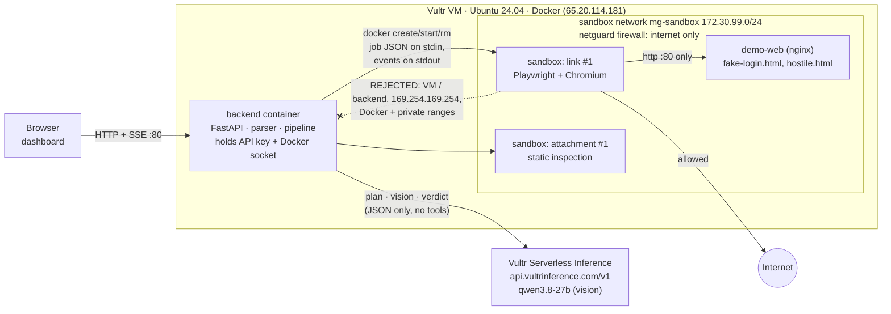

# 🛡️ MailGuard

**Checks incoming company email for phishing and malware by opening every link and attachment
inside a disposable, locked-down sandbox on Vultr. Never on the user's machine, never in the app process.**

- Each link is opened in a **fresh Playwright + Chromium container**. MailGuard follows redirects, takes screenshots, and records password forms, downloads and suspicious scripts.
- Each attachment is copied into a **fresh container** and inspected statically: type, hashes, macros, embedded links, EICAR. It is **never executed**.
- A vision model on **Vultr Serverless Inference** looks at the screenshots and judges whether the page is a fake login or brand impersonation.
- Verdict: **SAFE / SUSPICIOUS / DANGEROUS**, with reasons and the screenshot trail as proof.
- DANGEROUS mail goes to **quarantine**. A human must press **Release** before anything is delivered.
- A live dashboard (SSE) shows every step, including *container started* and *container destroyed*.

## Architecture



### Flow for one email

1. **Ingest:** paste, upload a `.eml`, or click a demo. The backend parses the sender, SPF/DKIM/DMARC, links (including *link text shows X but goes to Y*) and attachments. It only reads the email as data and never renders it.
2. **Plan:** the LLM picks which links to open and explains why. Policy: at most 4 links, at least one link is always opened, and **every attachment is always inspected**, whatever the model says.
3. **Links:** for each link, the backend runs `docker create` → `docker start -ai` on a new container. The runner streams NDJSON events back: logs, screenshots and the result. Then `docker rm -f`, and the backend checks that the container is gone. The dashboard shows `destroyed ✓`.
4. **Attachments:** each file is sent to a new container on stdin and written to a `noexec` tmpfs. The runner records the type (magic bytes), SHA-256/MD5, EICAR, MZ/ELF headers, double extensions, VBA macros (oletools), PDF `/JavaScript` `/Launch`, archive contents and embedded URLs.
5. **Vision:** the final screenshot goes to the vision model, together with the sandbox facts (final URL, form targets, scripts, blocked requests).
6. **Verdict:** deterministic evidence rules set a **floor**, and the LLM verdict can raise it but never lower it. If a hostile email talks the model into saying "SAFE", the dashboard shows *Guardrail: the model said SAFE, but sandbox evidence sets the floor at DANGEROUS*.
7. **Quarantine:** DANGEROUS email is held until someone presses **Release**. The release is logged with name and time.

## Containment (what every sandbox container gets)

| Control | How |
|---|---|
| Fresh container per link / attachment, destroyed after | `docker create` … `docker rm -f`, then a check that it no longer exists |
| No secrets | Only `HOME=/tmp` is passed. No `.env`, no volumes, no Docker socket |
| Read-only filesystem except `/tmp` | `--read-only --tmpfs /tmp:rw,noexec,nosuid,nodev,size=256m` |
| Memory / CPU / processes | `--memory 512m --memory-swap 512m --cpus 1 --pids-limit 256` |
| 60 s timeout | backend kills the container at 60 s (`SANDBOX_TIMEOUT`) |
| Non-root, no capabilities | `--user pwuser --cap-drop ALL --security-opt no-new-privileges` |
| Internet only | own bridge `mg-sandbox` + [`deploy/netguard.sh`](deploy/netguard.sh): `DOCKER-USER` and `INPUT` rules **reject** traffic to the VM itself (incl. its public IP / the backend), `169.254.169.254`, `10/8`, `172.16/12`, `192.168/16`, `100.64/10`, `127/8`. Only exception: the demo web server on port 80 |
| LLM cannot act | The model gets no tools. It receives data and returns JSON. Email and page text is wrapped in `<untrusted>` tags, and instructions inside them count as a prompt-injection signal |
| Dashboard never renders email HTML | All strings are inserted with `textContent` |

The **Containment** tab runs a probe container that tries to break out and shows the result live. It tries to run as root, read secrets from env, find the Docker socket, write to `/opt` and `/etc`, reach the metadata service, the Docker gateway, the backend and private IPs, and confirms the internet is reachable.

## Demo emails (`demo/`)

| File | What happens | Verdict |
|---|---|---|
| `safe.eml` | Colleague's meeting notes, link to docs.vultr.com (real internet) | SAFE |
| `phishing.eml` + `fake-login.html` | "Microsoft 365" from `micros0ft-account.test`. The link text shows `login.microsoftonline.com`. 302 → 302 → fake Microsoft login that posts the password to another domain and logs keystrokes | DANGEROUS |
| `hostile.eml` + `hostile.html` | Prompt injection in the email and hidden in the page. The page tries `169.254.169.254`, the backend, the Docker bridge and private IPs (all blocked), runs `eval(atob())`, and starts a drive-by `.xlsx.exe` download | DANGEROUS |
| `attachment.eml` | `Invoice_INV-4471.pdf.exe` containing the EICAR test file | DANGEROUS |

The `.html` pages are served by the `demo-web` nginx container, which is **only reachable from the sandbox network** under fake hostnames (Docker network aliases in `docker-compose.yml`). `attachment.eml` is generated by `demo/make_attachment_eml.py` (deploy runs it), so antivirus on laptops leaves the repo alone. To add a demo page, drop it in `demo/` and link to `http://docs.sharefile-portal.test/<file>.html`, or add a new alias.

## Deploy (one command on the VM)

```bash
ssh root@65.20.114.181
```

```bash
git clone https://github.com/SpeckoJedno/Hackathon-Vultr.git /opt/mailguard && cd /opt/mailguard
```

```bash
cp .env.example .env && nano .env   # set VULTR_INFERENCE_KEY
```

```bash
./deploy.sh
```

`deploy.sh` builds the sandbox image, starts `backend` and `demo-web` with Docker Compose, and installs the sandbox firewall as a systemd unit (`mailguard-netguard.service`), so it survives reboots. It then prints `/api/health`. Open **http://65.20.114.181**.

To update: `git pull && ./deploy.sh`. Logs: `docker compose logs -f backend`.

### Configuration (`.env`)

| Variable | Default | |
|---|---|---|
| `VULTR_INFERENCE_KEY` | – | Serverless Inference key. Without it MailGuard runs on rules only |
| `MODEL` / `VISION_MODEL` | `qwen3.8-27b` | Any model from `/v1/models` with `image` input and `text` output |
| `PUBLIC_HOST` | VM IP | Used by the firewall and the containment test |
| `SANDBOX_TIMEOUT` | `60` | Seconds before a sandbox is killed |
| `SANDBOX_PARALLEL` | `2` | Concurrent sandboxes (2 vCPU / 4 GB VM) |

To list vision-capable models (the endpoint is public):

```bash
curl -s https://api.vultrinference.com/v1/models | python3 -c "import json,sys; [print(m['id']) for m in json.load(sys.stdin)['data'] if any(i['type']=='image' for i in m.get('input_modalities',[])) and any(o['type']=='text' for o in m.get('output_modalities',[]))]"
```

## Files

```
docker-compose.yml        backend + demo-web + sandbox image build
deploy.sh                 one-command deploy on the VM
deploy/netguard.sh        sandbox firewall (internet only), + systemd unit
backend/app/main.py       REST API, SSE stream, quarantine/release, containment test
backend/app/pipeline.py   plan → links → attachments → vision → verdict (+ evidence floor)
backend/app/sandbox.py    starts/streams/destroys one container per job
backend/app/llm.py        Vultr Serverless Inference client + prompts (untrusted-data wrapping)
backend/app/parser.py     email parsing + static header/link checks
backend/app/static/       dashboard (vanilla JS, SSE)
sandbox/Dockerfile        Playwright + Chromium + oletools, runs as pwuser
sandbox/runner.py         runs inside the container: link / file / probe modes
demo/                     demo emails and pages
```

## API

`POST /api/emails` (form: `file`, `raw` or `demo`) · `GET /api/emails` · `GET /api/emails/{id}` ·
`POST /api/emails/{id}/release` · `POST /api/containment-test` · `GET /api/stream` (SSE) · `GET /api/health`

## Honest limits

- The backend holds the Docker socket, so it is trusted. The sandboxes are not, and they never get the socket.
- Containers share the host kernel. In production, add gVisor (`--runtime runsc`) or a microVM per job.
- Attachments get static analysis only. There is no dynamic detonation of executables and no AV engine (EICAR is detected by signature).
- State is a JSON file in `./data`, and nothing is really delivered by mail. "Delivered" is a status.
